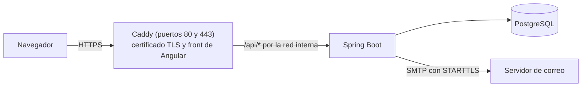
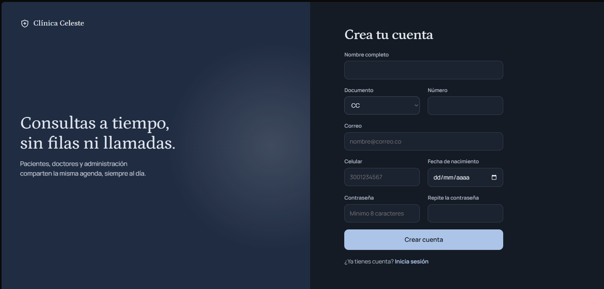
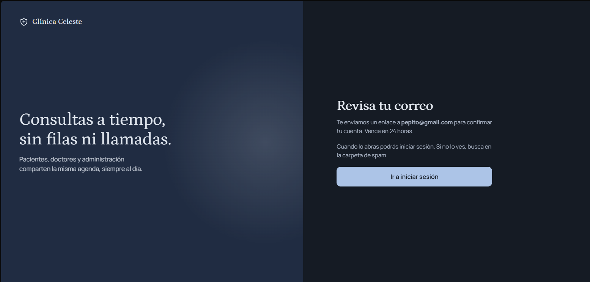
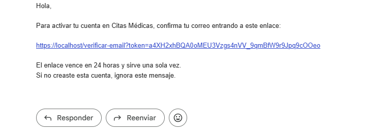
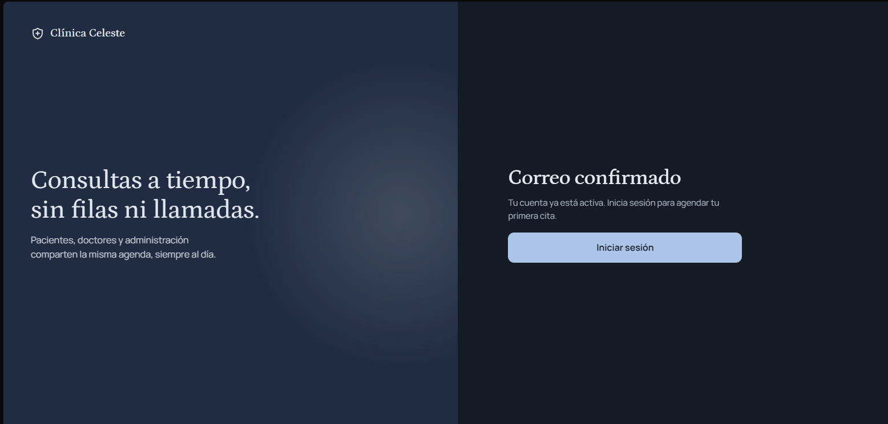
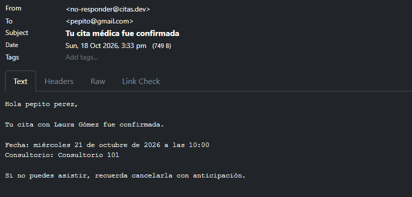
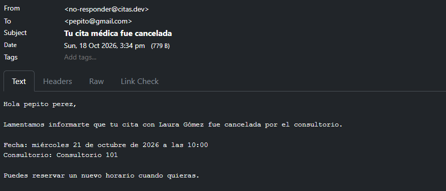
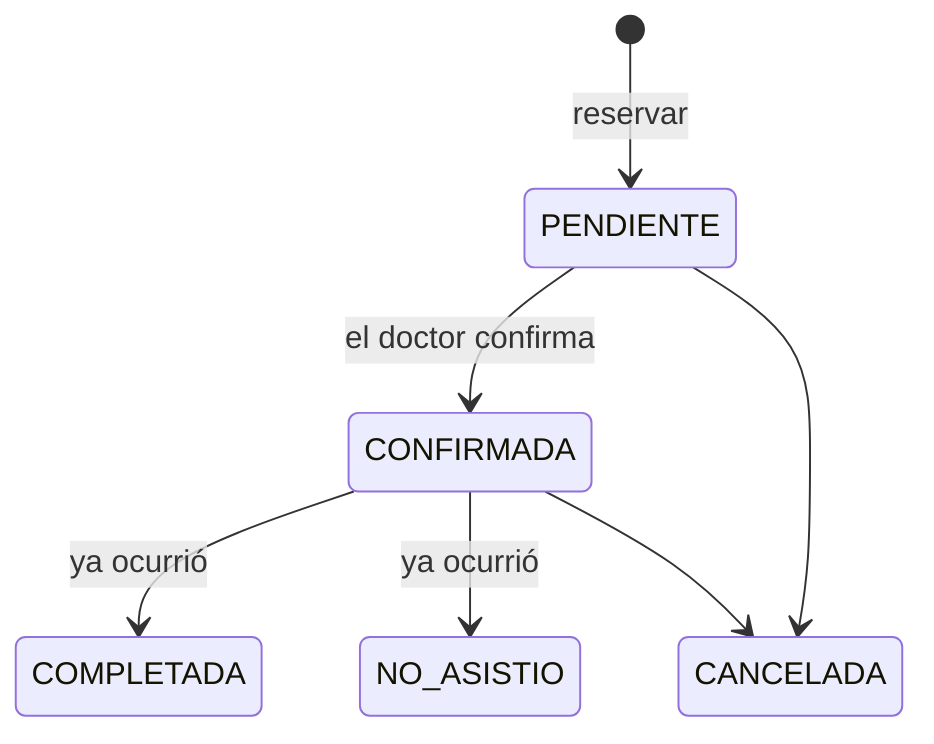

# Citas Médicas

Sistema para gestionar citas médicas: los pacientes reservan, cancelan y reprograman citas; los doctores administran su horario y su agenda; el administrador gestiona doctores y especialidades. Incluye notificaciones por correo, seguridad con JWT y despliegue con Docker y HTTPS.

**El fuerte del proyecto es el backend**: una API REST en Spring Boot con reglas de negocio, control de concurrencia, seguridad y tests de integración contra un PostgreSQL real. El front en Angular es la interfaz para usarla y se construyó con [Spec-Driven Development asistido por IA](#front-spec-driven-development-con-ia).

| Carpeta | Qué es |
|---|---|
| `medicas/` | API REST (Spring Boot), el núcleo del proyecto |
| `front/clinica-celeste/` | Front (Angular), que consume la API |

- **Backend:** Java 21 · Spring Boot 4 · Spring Security (JWT) · Spring Data JPA · PostgreSQL 18 · Flyway · JUnit 5 + Mockito + Testcontainers
- **Front:** Angular 21 · TypeScript
- **Infraestructura:** Docker Compose · Caddy



## Demo

### En video

Recorrido de cada rol con la clínica de ejemplo.

**Paciente:** agenda una cita eligiendo especialidad, doctor y horario, y después la reprograma.

https://github.com/user-attachments/assets/8afc8fd7-c5a2-4737-b361-2176cf97be34

**Doctor:** revisa su resumen y su agenda, cancela una cita y marca otra como atendida, y ajusta su horario semanal y sus bloqueos.

https://github.com/user-attachments/assets/0e012ece-0166-4558-a76d-cfec4c5e2ef3

**Administrador:** edita, deshabilita y crea doctores (con su certificado profesional) y gestiona las especialidades.

https://github.com/user-attachments/assets/0fd754b1-0f3a-454b-9e4a-6bcd9e2240b3


### Capturas

**Registro con verificación de correo**

| Formulario | Aviso al registrarse |
|:---:|:---:|
|  |  |
| **Correo con el enlace de un solo uso** | **Cuenta confirmada** |
|  |  |

**Correos al paciente cuando el doctor cambia su cita** (en desarrollo llegan a Mailpit)

| Confirmada | Cancelada por el consultorio |
|:---:|:---:|
|  |  |

### Probarla en tu PC

Por ahora no hay una versión publicada en internet. Para probarla en tu PC, levanta el proyecto como se explica en [Desarrollo](#desarrollo) y, en el login, usa **Entrar como paciente**, **Entrar como doctor** o **Entrar como administrador**: abren una cuenta de ejemplo sin registrarse.

El proyecto está listo para publicarse como demo. Con `DEMO_HABILITADA=true` (ver [Producción](#producción)), la API recrea una clínica de ejemplo al arrancar y cada noche, con fechas calculadas desde ese día. Las cuentas de demo no tienen una contraseña conocida (se entra con `POST /api/auth/demo`) y no reciben correos.

## Funcionalidades

| Rol | Puede |
|---|---|
| **Paciente** | Registrarse (con confirmación de email), ver especialidades, doctores y disponibilidad, reservar, cancelar y reprogramar sus citas, ver su historial paginado |
| **Doctor** | Definir su horario semanal y sus bloqueos (vacaciones, congresos), ver su agenda, confirmar, cancelar, completar o marcar como "no asistió" |
| **Admin** | Crear doctores (con su certificado profesional en PDF/JPG/PNG), desactivarlos y reactivarlos, gestionar especialidades |
| **Todos** | Iniciar sesión, cambiar su contraseña, recuperarla por correo |

Los pacientes reciben correos al confirmarse una cita, 24 horas antes y si el consultorio la cancela.

### Ciclo de vida de una cita



Reprogramar no cambia la fecha: cancela la cita y crea una nueva enlazada a la original, para conservar el historial.

## Decisiones técnicas del backend

**Concurrencia**
- **Sin reservas dobles**: un índice único parcial en PostgreSQL, probado con 10 reservas simultáneas.
- **Límite de citas por paciente** con bloqueo pesimista, y **bloqueo optimista** (`@Version`) en los cambios de una cita.

**Seguridad**
- **JWT revocable**: cambiar la contraseña o desactivar a un doctor cierra todas sus sesiones al instante.
- **Límite de intentos** por IP y por cuenta (`429` con `Retry-After`).
- **Tokens de un solo uso** para verificar el email y recuperar la contraseña; en la base solo se guarda su hash.
- **No revela qué cuentas existen** en el login ni en la recuperación de contraseña.
- **Archivos validados por su contenido**, no por la extensión.

**Diseño**
- **Máquina de estados** de la cita como datos, no como `if` dispersos.
- **Correos por eventos**, enviados después del commit, con recordatorios y reintentos.
- **Reloj inyectado** con la zona horaria de la clínica, para que los tests puedan congelar el tiempo.
- **Esquema versionado con Flyway** y **errores uniformes** con `ProblemDetail` (RFC 9457).

## Front: Spec-Driven Development con IA

Mi especialidad es el backend y Angular era una tecnología nueva para mí. Para construir el front apliqué **Spec-Driven Development (SDD)**: primero se escribe una especificación detallada y después el código se genera a partir de ella, en este caso con asistencia de IA (Claude Code).

1. **Especificación primero**: a partir de la API se definió qué hace cada pantalla (endpoints, códigos de error y cómo responder a cada uno), la arquitectura, las reglas de seguridad y un plan de pasos pequeños.
2. **Implementación con IA**, un paso a la vez y siguiendo la especificación.
3. **Revisión y verificación** de cada paso contra la API real, con pruebas automatizadas en el navegador (Playwright), antes de pasar al siguiente.

### Seguridad en el front

No bastaba con pedir "un front que funcione": la especificación incluyó reglas de seguridad que cada paso debía cumplir, y al final se hizo un repaso dedicado.

- **El JWT vive en `sessionStorage`**, no en `localStorage`: sobrevive a una recarga y se borra al cerrar la pestaña.
- **El token solo viaja a `/api`**, nunca a otros dominios (fuentes, CDNs).
- **Un `401` cierra la sesión en un solo lugar**, ya sea porque el token venció o porque la API lo revocó.
- **Los guards de rutas solo ordenan la navegación**: quien autoriza siempre es la API.
- **Protección contra XSS**: ningún dato del usuario se inserta como HTML; se usa el escapado automático de Angular.
- **El certificado del doctor se descarga con el token en la cabecera**, nunca en la URL.
- **El front no guarda credenciales**: ni las de la demo ni en la consola o en los mensajes de error.

## Cómo ejecutarlo

Todos los comandos parten de la raíz del repositorio.

### Desarrollo

Requisitos: Java 21, Node 22 y Docker Desktop abierto.

**1. API** (en una terminal):

```bash
cd medicas
./mvnw spring-boot:run -Dspring-boot.run.profiles=dev     # en Windows: mvnw.cmd ...
```

Spring Boot levanta solo los contenedores de `compose.yaml` (PostgreSQL, Mailpit y Caddy) y el perfil `dev` carga datos de prueba.

**2. Front** (en otra terminal):

```bash
cd front/clinica-celeste
npm install
npm start
```

El servidor de Angular reenvía `/api` a la API en el puerto 8080 (`proxy.conf.json`).

| Recurso | URL |
|---|---|
| **Front** | http://localhost:4200 |
| API | http://localhost:8080/api |
| Swagger (documentación interactiva) | http://localhost:8080/swagger-ui.html |
| Mailpit (bandeja de los correos enviados) | http://localhost:8025 |
| API por HTTPS (Caddy, certificado local) | https://localhost/api |

Usuarios de prueba, todos con la contraseña `clave123`: `paciente@citas.dev`, `doctor@citas.dev` y `admin@citas.dev`.

### Producción

Docker Compose levanta todo junto: API, base de datos y front.

```bash
cd medicas
cp .env.example .env      # completar los valores
docker compose -f compose.prod.yaml up -d --build
```

El sitio queda en `https://<DOMINIO>` (en tu PC, `https://localhost`). Desarrollo y producción no pueden correr a la vez: los dos usan los puertos 80 y 443.

Solo Caddy publica puertos (80 y 443) y obtiene el certificado de Let's Encrypt para `DOMINIO`. Caddy sirve el front de Angular (su imagen se construye desde `front/clinica-celeste/`) y reenvía solo `/api/*` a la app. La app y PostgreSQL quedan accesibles únicamente dentro de la red de Docker. La imagen se construye en dos etapas y corre con un usuario sin privilegios. En el perfil `prod` Swagger está apagado.

| Variable | Para qué |
|---|---|
| `DOMINIO` | Dominio público (también arma los enlaces de los correos) |
| `POSTGRES_DB`, `POSTGRES_USER`, `POSTGRES_PASSWORD` | Base de datos |
| `JWT_SECRET` | Clave de firma de los tokens (32 bytes en Base64: `openssl rand -base64 32`) |
| `MAIL_HOST`, `MAIL_PORT`, `MAIL_USERNAME`, `MAIL_PASSWORD`, `MAIL_REMITENTE` | Servidor SMTP (con STARTTLS obligatorio) |
| `ADMIN_EMAIL`, `ADMIN_PASSWORD`, `ADMIN_DOCUMENTO` | Primer administrador: se crea solo si no existe ninguno; borrarlas después del primer arranque |
| `DEMO_HABILITADA` | `true` solo en un despliegue de demostración: recrea la clínica de ejemplo al arrancar y cada noche, y **borra todo lo demás** salvo los administradores |

## Tests

```bash
cd medicas
./mvnw test
```

241 tests: 230 unitarios (JUnit 5 + Mockito) y 11 de integración con Testcontainers, que levantan un PostgreSQL real (requieren Docker). Incluyen la carrera de 10 reservas simultáneas, el límite de reservas bajo concurrencia, la cantidad de consultas SQL de los listados (sin N+1), el `CHECK` de emails y el reinicio de la demo.

## Estructura

```
medicas/src/main/java/com/citas/medicas
 ├── controller       endpoints REST, documentados con OpenAPI
 ├── service          reglas de negocio
 ├── repository       Spring Data JPA
 ├── entity           entidades y enums
 ├── dto              records de entrada y salida (las entidades nunca se exponen)
 ├── security         JWT, límites de intentos
 ├── notification     correos y notificaciones
 ├── scheduler        recordatorios y reintentos programados
 ├── evento           eventos de dominio
 ├── almacenamiento   archivos subidos
 ├── exception        excepciones de negocio y manejador global
 ├── config           seguridad, reloj, tareas asíncronas, admin inicial
 └── demo             reinicio nocturno de la clínica de ejemplo
medicas/src/main/resources/db    migraciones de Flyway (y datos de prueba de dev)
medicas/src/main/resources/demo  la clínica de ejemplo de la demo

front/clinica-celeste/src/app
 ├── core             cliente de la API, sesión, interceptores HTTP
 ├── features         vistas por rol: paciente, doctor, admin, login y cuenta
 ├── layout           marco de la app y del acceso
 └── shared           componentes e íconos reutilizables
```

## Autor

**Daniel Hurtado** · Desarrollador backend

- LinkedIn: [Daniel Hurtado](https://www.linkedin.com/in/dani-hurtado13/)
- Correo: hurtadodaniel313@gmail.com
