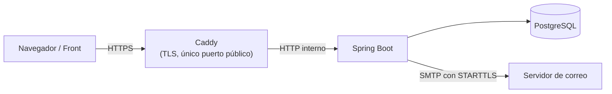
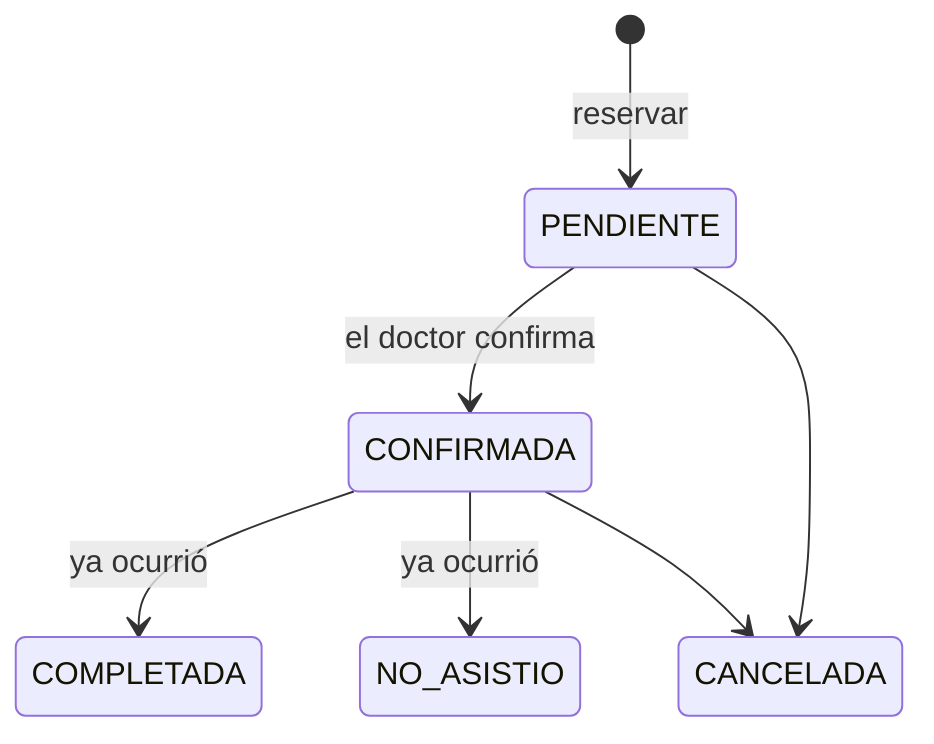

# Citas Médicas

Sistema para gestionar citas médicas: los pacientes reservan, cancelan y reprograman citas; los doctores administran su horario y su agenda; el administrador gestiona doctores y especialidades. Incluye notificaciones por correo, seguridad con JWT y despliegue con Docker y HTTPS.

El repositorio tiene dos partes:

| Carpeta | Qué es |
|---|---|
| `medicas/` | API REST (Spring Boot) |
| `front/clinica-celeste/` | Front (Angular), que consume la API |

**Stack:** Java 21 · Spring Boot 4 · Spring Security (JWT) · Spring Data JPA · PostgreSQL 18 · Flyway · JUnit 5 + Mockito + Testcontainers · Angular 21 · Docker · Caddy



## Funcionalidades

| Rol | Puede |
|---|---|
| **Paciente** | Registrarse (con confirmación de email), ver especialidades, doctores y disponibilidad, reservar, cancelar y reprogramar sus citas, ver su historial paginado |
| **Doctor** | Definir su horario semanal y sus bloqueos (vacaciones, congresos), ver su agenda, confirmar, cancelar, completar o marcar como "no asistió" |
| **Admin** | Crear doctores (con su certificado profesional en PDF/JPG/PNG), desactivarlos y reactivarlos, gestionar especialidades |
| **Todos** | Iniciar sesión, cambiar su contraseña, recuperarla por correo |

Los pacientes reciben correos al confirmarse una cita, 24 horas antes y si el consultorio la cancela.

**Demo:** el login ofrece entrar como paciente, doctor o administrador de una clínica de ejemplo, sin registrarse. Esas cuentas no tienen una contraseña conocida (se entra con `POST /api/auth/demo`), no reciben correos, y la clínica se recrea cada noche con fechas calculadas desde ese día.

### Ciclo de vida de una cita



Reprogramar no cambia la fecha: cancela la cita y crea una nueva enlazada a la original, para conservar el historial.

## Decisiones técnicas destacadas

**Concurrencia**
- **Sin reservas dobles**: un índice único parcial en PostgreSQL (`doctor_id, fecha_hora` donde la cita no está cancelada) es la barrera final cuando dos pacientes reservan el mismo horario a la vez; el segundo recibe `409`. Probado con 10 reservas simultáneas contra un PostgreSQL real (Testcontainers).
- **Límite de citas por paciente** (3 activas, 1 por doctor) con bloqueo pesimista (`SELECT … FOR UPDATE`): sin él, 8 reservas simultáneas de un mismo paciente pasaban todas.
- **Bloqueo optimista** (`@Version`) para que dos cambios simultáneos sobre una cita no se pisen.

**Seguridad**
- **JWT revocable**: cada usuario tiene una versión de sesión que viaja en el token. Cambiar o restablecer la contraseña, o desactivar a un doctor, invalida al instante todas sus sesiones.
- **Límite de intentos** por IP (login, registro y endpoints que envían correos) y por cuenta (5 fallos de login), con `429` y `Retry-After`.
- **Verificación de email y recuperación de contraseña** con tokens aleatorios de un solo uso que vencen (24 h y 30 min). En la base solo se guarda su hash SHA-256, y el "un solo uso" lo garantiza un `DELETE` atómico.
- **No revela qué cuentas existen**: el login responde lo mismo para un email inexistente o una contraseña incorrecta, y los endpoints de reenvío y recuperación responden siempre `202`.
- **Archivos validados por contenido**: el certificado del doctor se comprueba por sus primeros bytes (no solo por la extensión) y se guarda con un nombre UUID, nunca con el original.
- **Emails sin distinguir mayúsculas**, normalizados en el código y exigidos por un `CHECK` en la base.
- **Demo pública sin llaves que robar**: las cuentas de demo guardan el hash de un secreto aleatorio descartado, así que nadie puede cambiarles la contraseña y dejar afuera a los demás. Un reinicio nocturno, en una sola transacción, deshace cualquier otro cambio.

**Diseño**
- **Máquina de estados como datos**: un `Map` inmutable de transiciones permitidas en lugar de `if` dispersos.
- **Correos desacoplados**: los servicios publican eventos; los correos se envían después del commit (`@TransactionalEventListener` + `@Async`), con recordatorios programados y hasta 3 reintentos si el servidor de correo falla.
- **Hora de la clínica explícita**: un `Clock` inyectado con la zona configurada. Al contenerizar, la app corría en UTC y creía que eran 5 horas más tarde; con el reloj inyectado, además, los tests pueden congelar el tiempo.
- **Esquema versionado con Flyway** y `ddl-auto=validate`: Hibernate comprueba al arrancar que las entidades coinciden con las tablas.
- **Errores uniformes** con `ProblemDetail` (RFC 9457) y mensajes en español.

## Cómo ejecutarlo

Todos los comandos parten de la raíz del repositorio.

### Desarrollo

Requisitos: Java 21, Node 22 y Docker Desktop abierto.

**1. API** (en una terminal):

```bash
cd medicas
./mvnw spring-boot:run -Dspring-boot.run.profiles=dev     # en Windows: mvnw.cmd ...
```

Spring Boot levanta solo los contenedores de `compose.yaml` (PostgreSQL, Mailpit y Caddy) y el perfil `dev` carga datos de prueba.

**2. Front** (en otra terminal):

```bash
cd front/clinica-celeste
npm install
npm start
```

El servidor de Angular reenvía `/api` a la API en el puerto 8080 (`proxy.conf.json`).

| Recurso | URL |
|---|---|
| **Front** | http://localhost:4200 |
| API | http://localhost:8080/api |
| Swagger (documentación interactiva) | http://localhost:8080/swagger-ui.html |
| Mailpit (bandeja de los correos enviados) | http://localhost:8025 |
| API por HTTPS (Caddy, certificado local) | https://localhost/api |

Usuarios de prueba, todos con la contraseña `clave123`: `paciente@citas.dev`, `doctor@citas.dev` y `admin@citas.dev`.

### Producción

Docker Compose levanta todo junto: API, base de datos y front.

```bash
cd medicas
cp .env.example .env      # completar los valores
docker compose -f compose.prod.yaml up -d --build
```

El sitio queda en `https://<DOMINIO>` (en tu PC, `https://localhost`). Desarrollo y producción no pueden correr a la vez: los dos usan los puertos 80 y 443.

Solo Caddy publica puertos (80 y 443) y obtiene el certificado de Let's Encrypt para `DOMINIO`. Caddy sirve el front de Angular (su imagen se construye desde `front/clinica-celeste/`) y reenvía solo `/api/*` a la app. La app y PostgreSQL quedan accesibles únicamente dentro de la red de Docker. La imagen se construye en dos etapas y corre con un usuario sin privilegios. En el perfil `prod` Swagger está apagado.

| Variable | Para qué |
|---|---|
| `DOMINIO` | Dominio público (también arma los enlaces de los correos) |
| `POSTGRES_DB`, `POSTGRES_USER`, `POSTGRES_PASSWORD` | Base de datos |
| `JWT_SECRET` | Clave de firma de los tokens (32 bytes en Base64: `openssl rand -base64 32`) |
| `MAIL_HOST`, `MAIL_PORT`, `MAIL_USERNAME`, `MAIL_PASSWORD`, `MAIL_REMITENTE` | Servidor SMTP (con STARTTLS obligatorio) |
| `ADMIN_EMAIL`, `ADMIN_PASSWORD`, `ADMIN_DOCUMENTO` | Primer administrador: se crea solo si no existe ninguno; borrarlas después del primer arranque |
| `DEMO_HABILITADA` | `true` solo en un despliegue de demostración: recrea la clínica de ejemplo al arrancar y cada noche, y **borra todo lo demás** salvo los administradores |

## Tests

```bash
cd medicas
./mvnw test
```

241 tests: 230 unitarios (JUnit 5 + Mockito) y 11 de integración con Testcontainers, que levantan un PostgreSQL real (requieren Docker). Incluyen la carrera de 10 reservas simultáneas, el límite de reservas bajo concurrencia, la cantidad de consultas SQL de los listados (sin N+1), el `CHECK` de emails y el reinicio de la demo.

## Estructura

```
medicas/src/main/java/com/citas/medicas
 ├── controller       endpoints REST, documentados con OpenAPI
 ├── service          reglas de negocio
 ├── repository       Spring Data JPA
 ├── entity           entidades y enums
 ├── dto              records de entrada y salida (las entidades nunca se exponen)
 ├── security         JWT, límites de intentos
 ├── notification     correos y notificaciones
 ├── scheduler        recordatorios y reintentos programados
 ├── evento           eventos de dominio
 ├── almacenamiento   archivos subidos
 ├── exception        excepciones de negocio y manejador global
 ├── config           seguridad, reloj, tareas asíncronas, admin inicial
 └── demo             reinicio nocturno de la clínica de ejemplo
medicas/src/main/resources/db    migraciones de Flyway (y datos de prueba de dev)
medicas/src/main/resources/demo  la clínica de ejemplo de la demo

front/clinica-celeste/src/app
 ├── core             cliente de la API, sesión, interceptores HTTP
 ├── features         vistas por rol: paciente, doctor, admin, login y cuenta
 ├── layout           marco de la app y del acceso
 └── shared           componentes e íconos reutilizables
```
